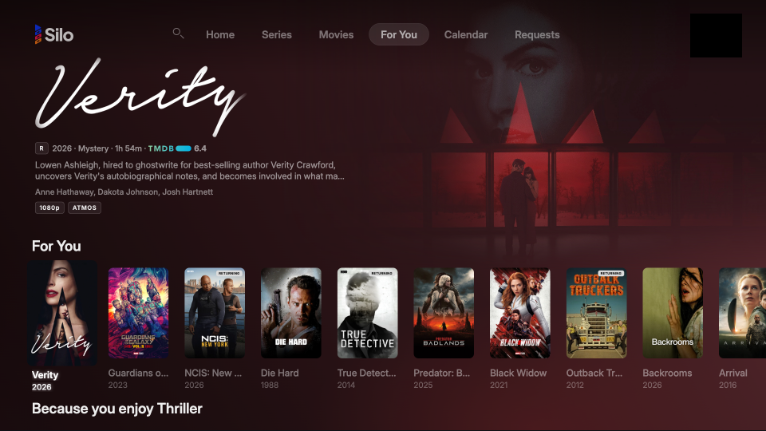

# Silo Tizen

Samsung TV client for the [Silo](https://github.com/Silo-Server/silo-server) self-hosted media server.

This repo builds a Tizen web app (`.wgt`) for Samsung TVs running Tizen 8.0 or later.
The installed OS version, not the TV's model year, decides compatibility; earlier Tizen versions are not supported.
It talks to Silo's native `/api/v2` and plays through Samsung's AVPlay.

## Tester builds

The newest tester build is always at [`silo-tizen-latest-beta.wgt`](https://github.com/Silo-Server/silo-tizen/releases/download/beta-latest/silo-tizen-latest-beta.wgt), with versioned builds and checksums on [Releases](https://github.com/Silo-Server/silo-tizen/releases).
A tester build installs only on TVs listed in its signing certificate; see [Releasing](docs/releasing.md#installing-a-tester-build).

## Screenshots

<p>
  
</p>

## Layout

- `app/` - package manifest (`config.xml`), HTML entry, icon, fonts and third-party marks
- `src/api/`, `src/session/`, `src/contracts/v2/` - native transport, sessions, profile authority and contract decoders
- `src/ui/` - sign-in, profile/PIN, browse and settings screens, and remote focus
- `src/player/` - server playback plan, AVPlay transport, progress, final stop and track changes
- `scripts/` - build, packaging and release scripts
- `test/` - native contract tests and Playwright screen tests
- `docs/` - behaviour, design and validation notes; start with [App behaviour](docs/app-behaviour.md)

## Prerequisites

- Node.js 26 or later
- Tizen Studio Web CLI and a Certificate Manager security profile, for packaging
- A running Silo server for sign-in, browsing and playback validation
- A Samsung TV in Developer Mode, or the Samsung TV simulator, for runtime checks

## Build

Tizen 8.0 uses Chromium 108 ([Samsung web engine specifications](https://developer.samsung.com/smarttv/develop/specifications/web-engine-specifications.html)).
TypeScript checks ES2022 and DOM code in strict mode; tests additionally load Node types.
esbuild emits a classic script targeting `chrome108`.
Neither step supplies missing browser APIs or CSS support.

```sh
npm ci
npx playwright install chromium   # browser for the screen tests
npm run build
```

`scripts/build.mjs` stages `app/` into `dist/wgt/` and emits `js/main.js` and `js/main.css`.
The bundle's app version comes from `app/config.xml`.

## Test

`npm test` runs both strict type checks, the production build, native contract/session/player tests and Playwright screen/composition tests.
See [test/README.md](test/README.md) for the test boundaries, and [Samsung simulator evidence](docs/simulator-evidence.md) for the simulator recipe, signed-package identity checks and Apple TV comparisons.

## Signing

Packaging signs with a Tizen Studio Certificate Manager security profile.
Never commit certificates, profile XML or passwords.

```sh
export TIZEN_SECURITY_PROFILE="YourProfileName"
./scripts/build-wgt.sh
```

The script builds the package staging directory and writes `dist/Silo.wgt`.

CI builds the same package on every pull request and push to main (`.github/workflows/tizen-build.yml`).
On main and same-repository pull requests it signs with the maintainer's Samsung certificate from repository secrets and uploads `Silo.wgt` with its SHA-256 as the `silo-tizen-wgt` artifact.
That certificate lists the TVs it may install on, so a CI-signed package installs only on those TVs.

## Release Flow

Tester builds and store releases are made by the Release and Promote workflows from `main`; see [Releasing](docs/releasing.md).
Samsung TV Seller Office has no upload API, so store submission is a manual step.

## Contributing

Right now, the most helpful way to contribute is a clear, accurate issue. We
implement and review changes through our own workflow, and pull request volume
has outgrown what we can review carefully, so a good issue usually helps us
more than a pull request.

Pull requests are still welcome from contributors who've had one merged in a
Silo repository, or when a maintainer asks for one. We close other pull
requests without review. [CONTRIBUTING.md](CONTRIBUTING.md) explains what makes
an issue useful.

## License & Trademarks

Silo Tizen is licensed under `AGPL-3.0-or-later` with an additional
permission under AGPL section 7 allowing distribution through the Samsung TV
Apps store despite its signing, DRM, and redistribution terms. See
[LICENSE](LICENSE) and [APPSTORE-EXCEPTION.md](APPSTORE-EXCEPTION.md). A second
additional permission allows combining it with platform SDKs; see
[PLATFORM-EXCEPTION.md](PLATFORM-EXCEPTION.md).

The **Silo name, logo, and wordmark are trademarks of Silo Media L.L.C.** and
are **not** covered by the AGPL. You're free to fork and redistribute the code,
but forks and modified redistributions must not use the Silo brand as their
identity and must remove or replace the brand assets. Official, unmodified
builds may be redistributed under the Silo name with all notices kept intact.
Publishing a Silo-branded app to an app
store requires written permission. See [TRADEMARK.md](TRADEMARK.md) for what's
permitted — including referential use like "compatible with Silo."

Third-party code, fonts and marks retain their own licenses. See [THIRD_PARTY_NOTICES.md](THIRD_PARTY_NOTICES.md).
