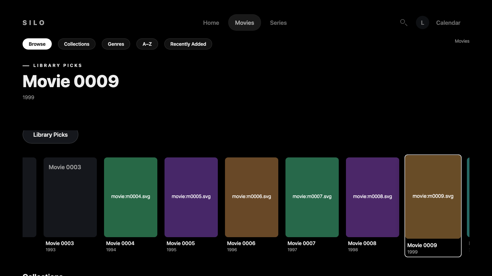
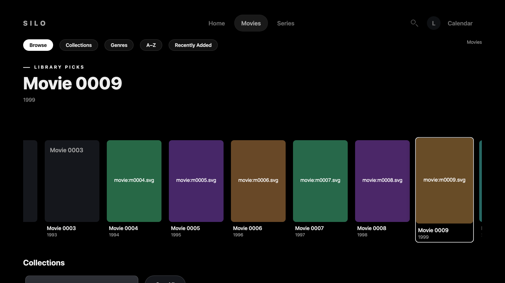
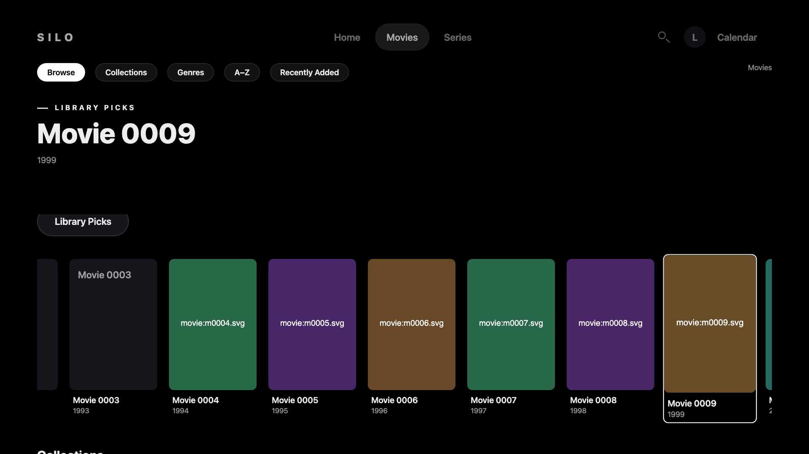
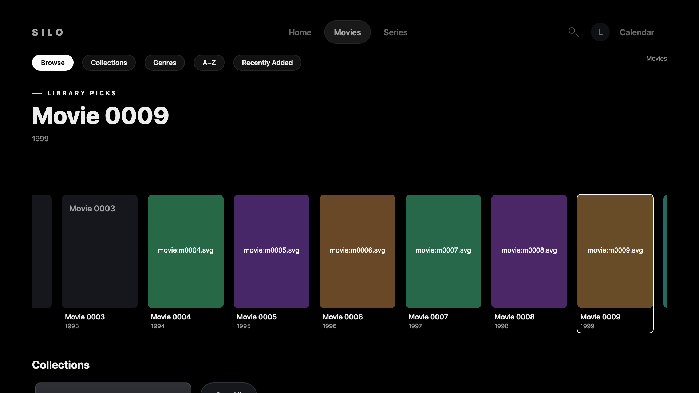

# Library focus restoration evidence

Candidate: `86ce0a81f5820c56059ac73393a71fba1636b967`.
Baseline: `3442bccc47944dc170054c7b6500a4ce07686cd3`.
Candidate tree: `fb120c6c9ed49d3248457e636c5c6ced75b81965`.

These 1920×1080 captures use the same synthetic library and remote journey.
The candidate executes HTML, JavaScript and CSS extracted from its signed package.
After committing scroll 100 on Movie 0009, the journey opens Details and presses Back.
Main returns to scroll 19; the candidate returns to 100 with the same card and horizontal shelf position.
Both versions show the full focus border in these captures.

[4.64-second signed-entry capture](focus-return.mp4)

The recording includes synthetic sign-in with an accelerated polling clock.
The Details and Back journey runs on the real-time browser animation clock after sign-in.
The clip contains no live account, private server, private media or production credential.
The signed package and private logs are not uploaded.

This is desktop Chromium presentation evidence, not actual Chromium 76, Samsung simulator, physical remote, TV, AVPlay or live-backend acceptance.
This evidence branch is kept for PR review and is not merged into the app branch.
