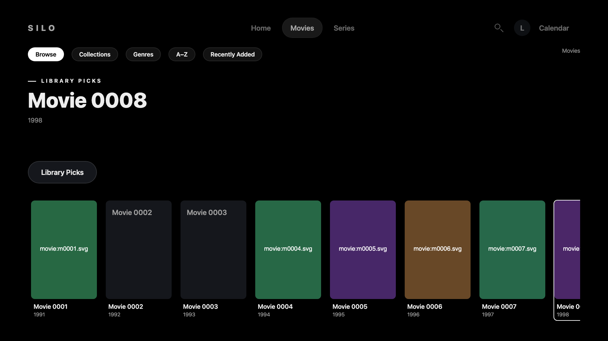
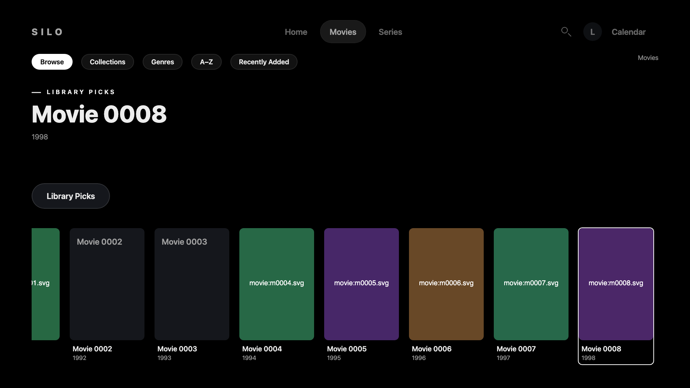
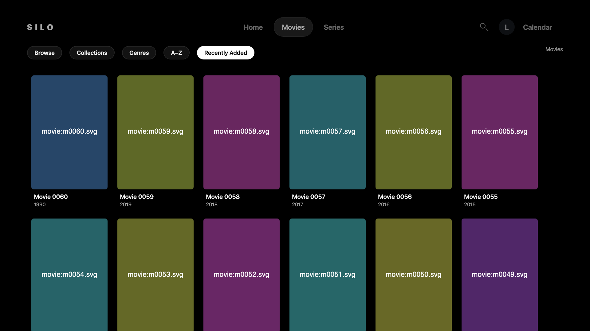
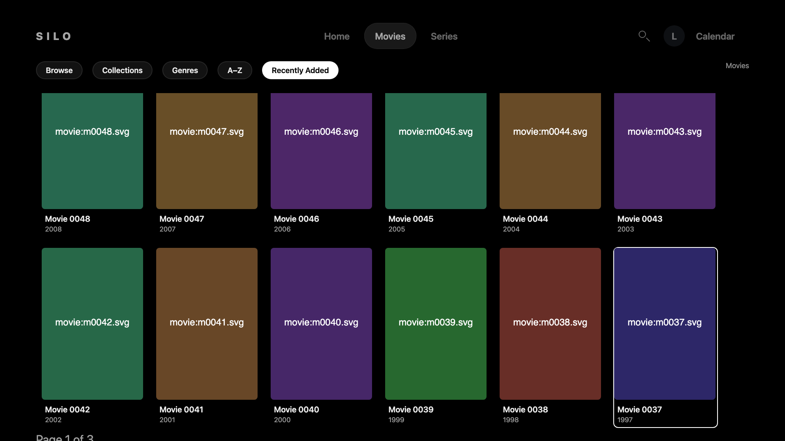
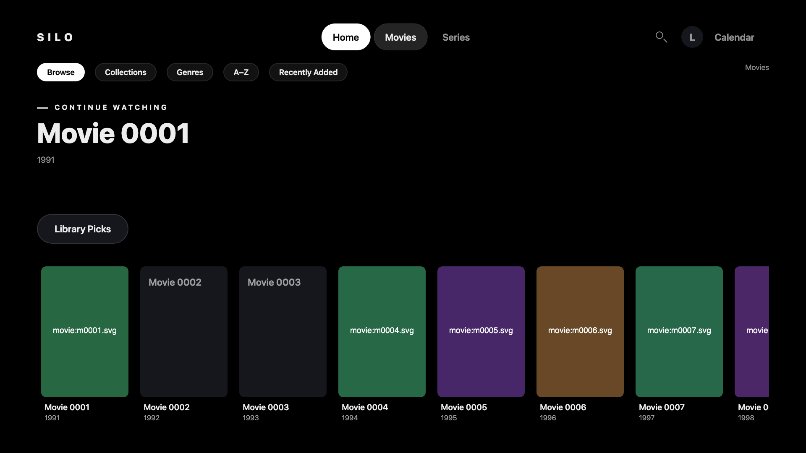
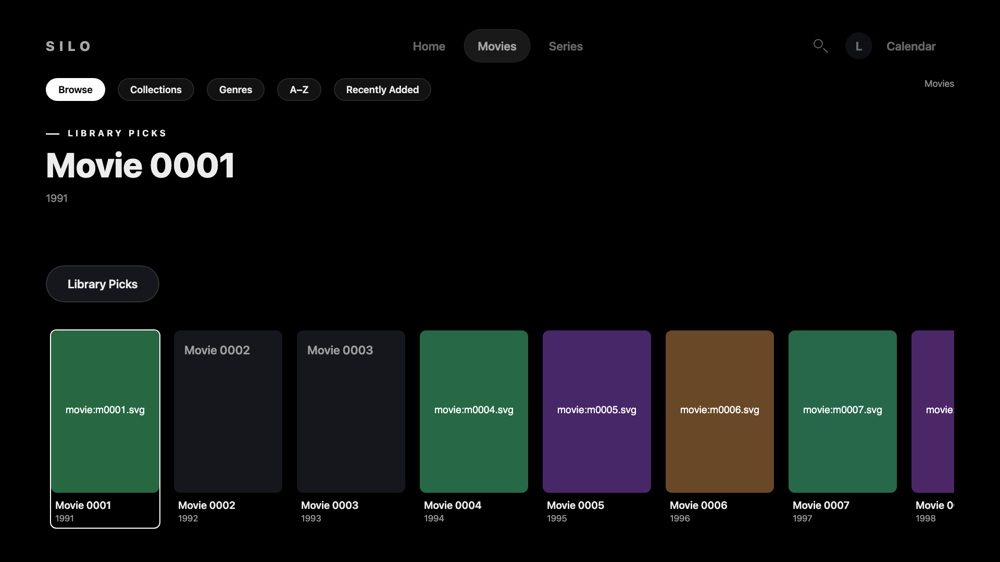

# Focus return review fixes

Current source: `ce0b143b4393ec1df3f230ef64e39cd525f4a01f`.
Baseline source: `86ce0a81f5820c56059ac73393a71fba1636b967`.
Current tree: `2281916d071ab372a3d44974e0c0d1c04a9d9a7a`.

Both versions execute their signed-package entry HTML, JavaScript and CSS in desktop Chromium with the same synthetic data at 1920×1080.
These journeys use reduced motion, where reveal scrolling applies immediately.

The navigation journey also pressed Select: baseline returned Home, while the candidate opened the movie's Details.

[Reduced-motion shelf return recording](reduced-shelf-return.mp4)

Synthetic sign-in uses an accelerated polling clock; the post-login journey runs in real time.
The clip was fully decoded, and the screenshots retain their captured pixels with ancillary metadata removed.
Only synthetic media is included; signed packages, private logs, credentials, private hosts and live accounts remain excluded.

Normal and reduced motion are both covered by regression tests.
These captures do not establish actual Chromium 76 runtime, a Samsung simulator, a physical remote, TV hardware, AVPlay or live-backend acceptance.
This evidence branch is separate from the app source branch.
