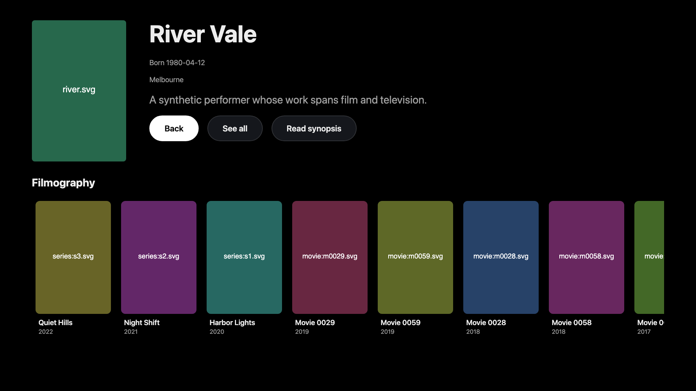
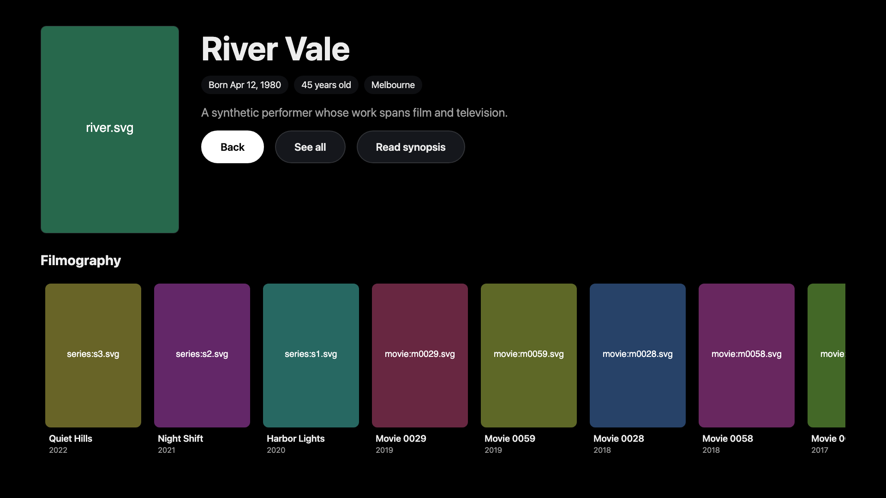
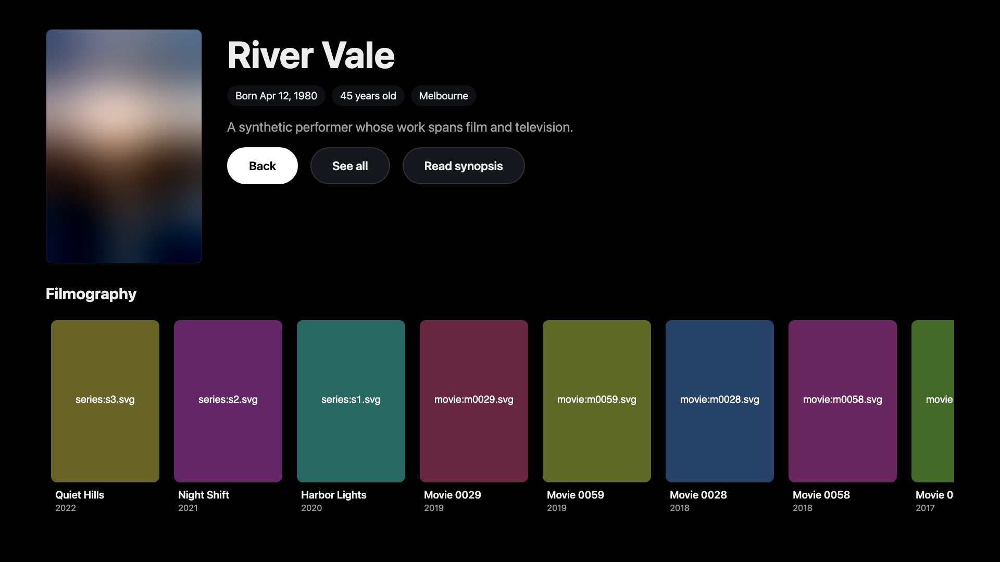
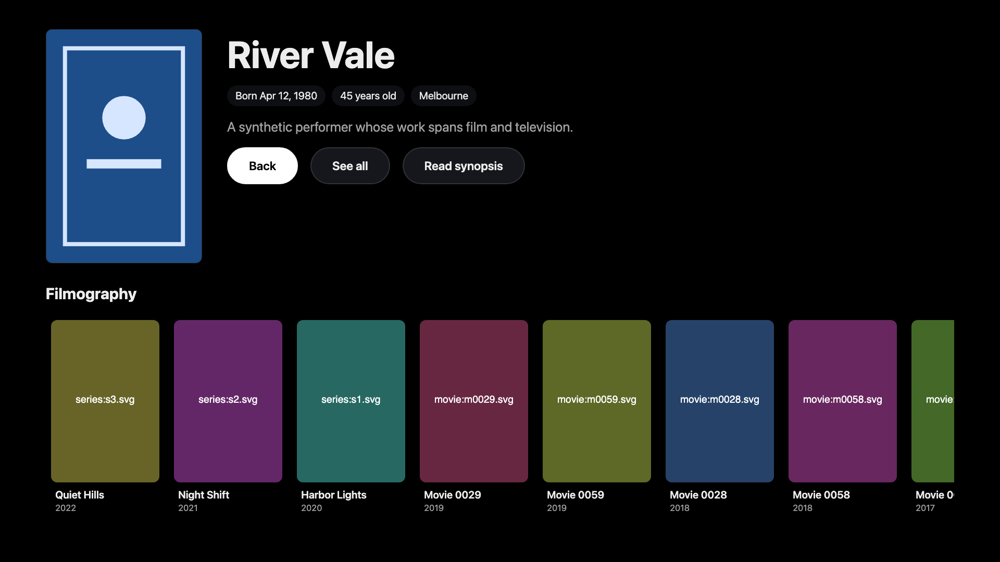
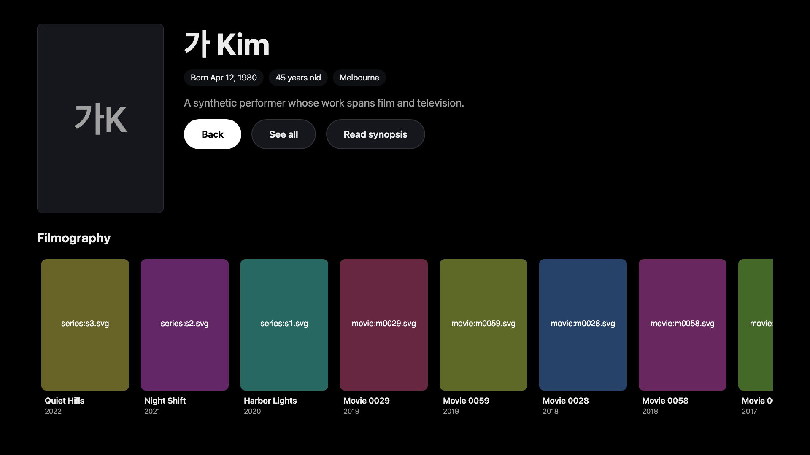
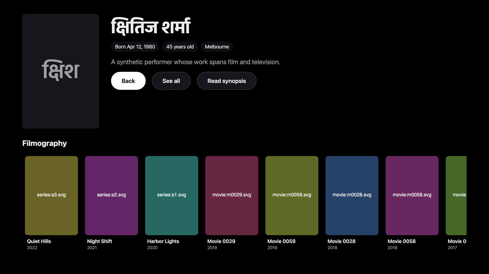

# Person hero evidence

Source candidate: `dcb65ec4f2a3ba8ddd76f77670ce89ed37f8ed65`.
Baseline: `1ffd056cb9e6997807b541e5e3fec29e8eecf293`.
The candidate tree is `3c29a67ffcc45aa4a9d37dbac2c802e7d44155bb`.

These captures use the same synthetic person and a fixed local date of 11 April 2026 at 1920×1080.
The candidate executes HTML, JavaScript and CSS extracted from its signed package.
No live account, private media, server address, credential or signed package is included here.

[Portrait loading and remote focus recording](person-hero-fade.mp4)

The recording runs at normal speed for 9.72 seconds.
Reduced motion was separately checked with a zero-second fade.
This is desktop Chromium presentation evidence, not actual Chromium 76, Samsung simulator, TV hardware, AVPlay or live-backend acceptance.

These files are held on the repository's evidence branch for PR review.
