# Requests artwork regression evidence

Requests previously rendered text-only cards even when the native contract supplied a poster path.
The signed candidate resolves those TMDB paths and displays posters through the existing artwork owner.
Request IDs, actions and status wording are unchanged.

## Same-screen comparisons

Both builds used the same profile and content on 4 November 2026.
The baseline was signed source `13354eb564e23a90dcb44cadfb2f7be205376a45`, whose Requests presentation matches the current-main base before this change.
The candidate was signed source `b3f04f68b6d677c83602eec6df0c1a97daee43a2`, including main through #179.

| Surface | Before | After |
| --- | --- | --- |
| Discovery | 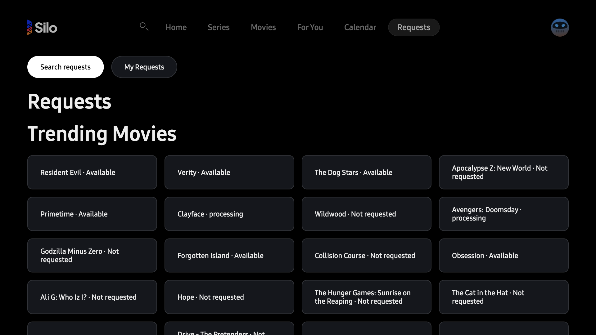 | 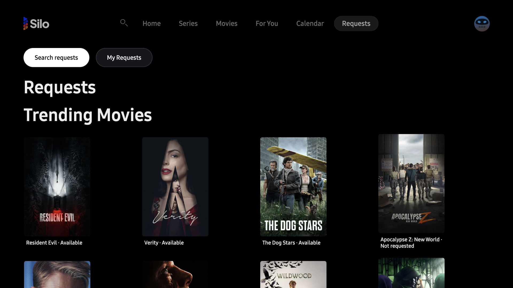 |
| Expanded row | 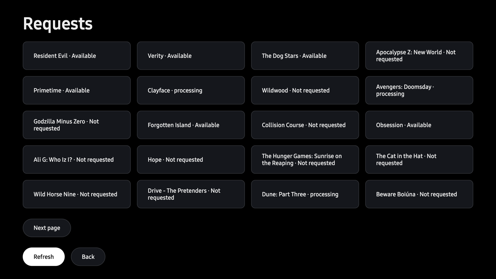 | 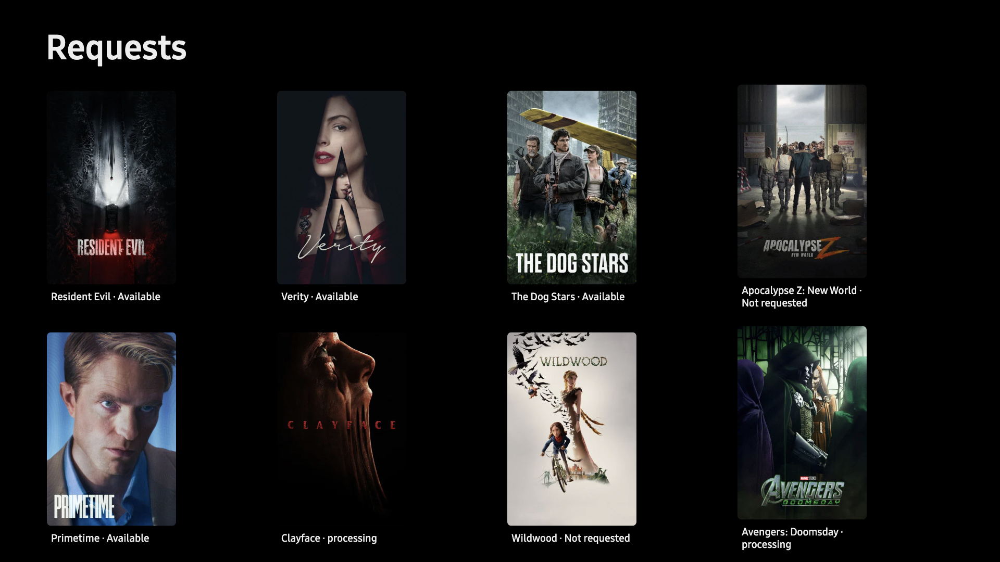 |
| Requests search | 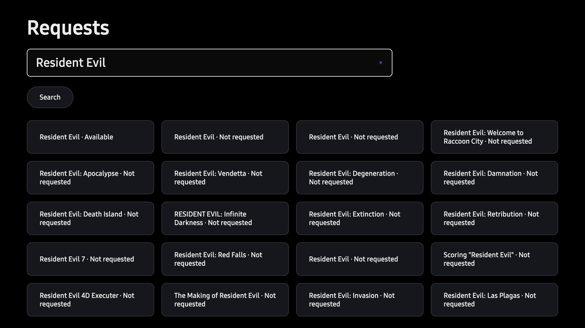 | 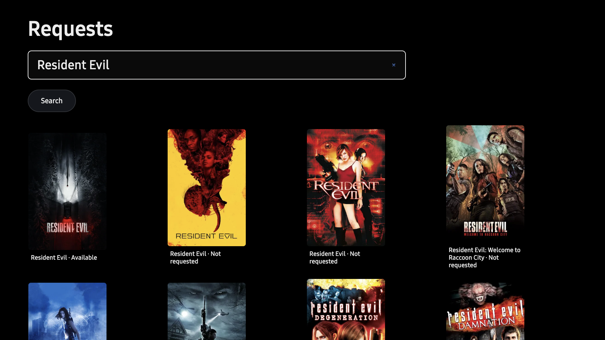 |
| My Requests | 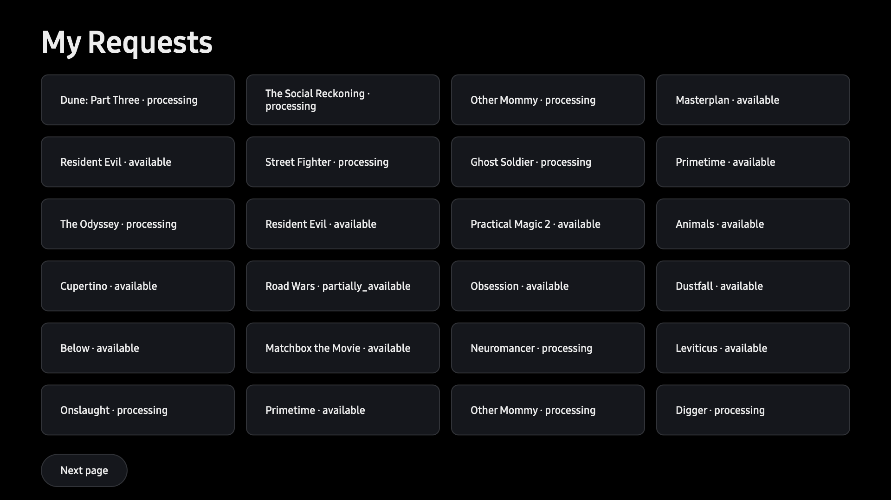 | 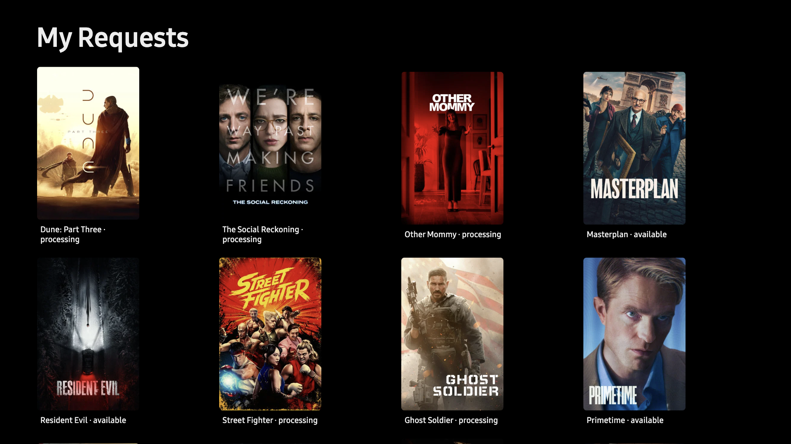 |
| Media detail | 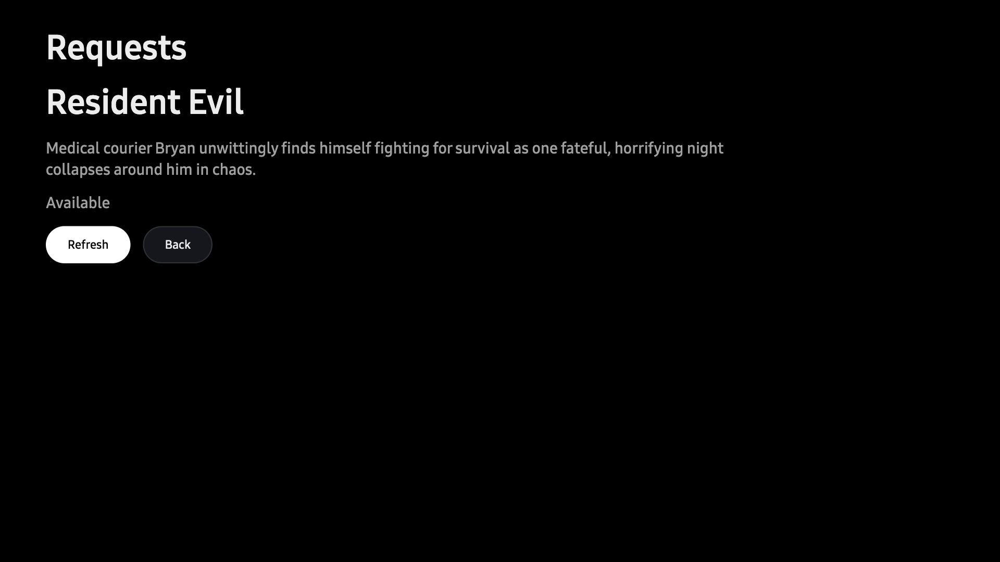 | 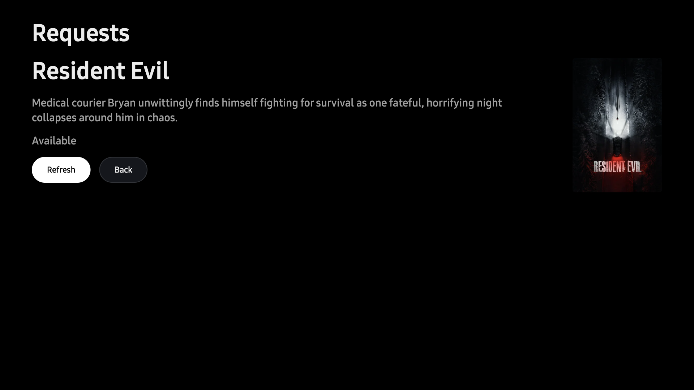 |
| Request detail | 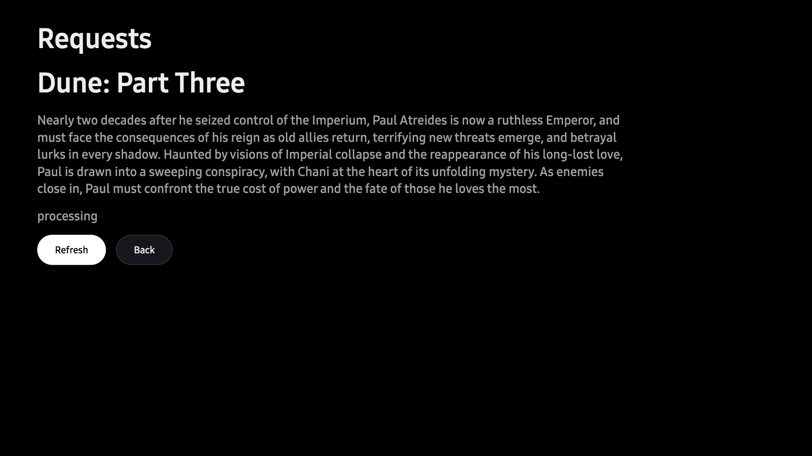 | 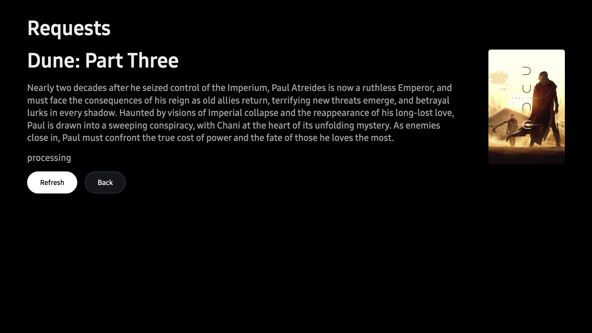 |

The taller cards show fewer rows at once; each comparison starts at the same screen position and retains the same leading titles.
The images show public title artwork and metadata plus anonymous availability/request state and a non-identifying avatar.
No account name, server/address, login code, credential or desktop content is included.
GitHub attachment upload was unavailable, so these files remain as regression documentation.

## Signed runtime observations

The Samsung simulator used SDK 10.0.6, Chromium 137, a 1920×1080 app viewport and device pixel ratio 2.
The WGT SHA-256 was `6cb55d62dbd17b560a699465ef3c7ba3564d3fa65ceb1c761fd9257e6b207ff5`.
All 15 installed archive files matched the package.
Loaded JavaScript matched the packaged build: SHA-256 `9d0f042b9ebac55e836d003ad3ad6cc2b7dd77daf0dbe564956de9b0ad693c6f`, 835283 bytes.
[Installed asset hashes](installed-assets.json) and [capture hashes](evidence.json) retain those identities.

The live discovery contained 120 cards, My Requests contained 24, and the expanded row contained 20.
Visible posters decoded at 342×513; captures show only the visible portion of each list.
The initial artwork candidate supplied 16 observed CDN requests with HTTP 200 and no Authorization or Referer in the transmitted headers.
The artwork source remained byte-identical after the main integration; the final package and captures were refreshed.

The desktop remained locked.
One persistent SDK debugging connection enabled focus emulation.
Entry and search used diagnostic pointer/input operations; arrow and TV Back input used SDK key dispatch.
Down/Right/Left moved between cards with the API-read count unchanged at 134.
Pointer activation opened media detail, and a subsequent TV Back restored the originating card.
[The 19.8-second recording](remote-artwork-entry.mp4) shows arrows and pointer entry through loading to the poster; it ends before Back.
It uses 11 observed source frames with their elapsed timestamps, plus one repeated final frame, cropped to the app without scaling and without audio.

For the [failure capture](error-fallback.png), the debugger changed one image URL to a deliberately missing CDN path.
The actual image failure displayed the existing title placeholder, removed the failed image and retained focus.
This is fault injection, not a claim that the provider naturally returned that missing image.
No create, cancel or follow action was invoked during these captures.

## Limits and follow-up

This delivers artwork for #76, not the complete Requests redesign in #98.
The four-column Tizen layout, existing focus treatment and current status wording remain; #74/#75/#98 own their respective follow-up work.
No same-state Apple capture was made because tvOS was unavailable through the required device interface.
The pinned Apple image helper supplies the `w342` convention, but these captures do not establish Apple layout parity.
Physical TV, packaged-origin CORS, AVPlay and final TV acceptance remain unverified under #106.
