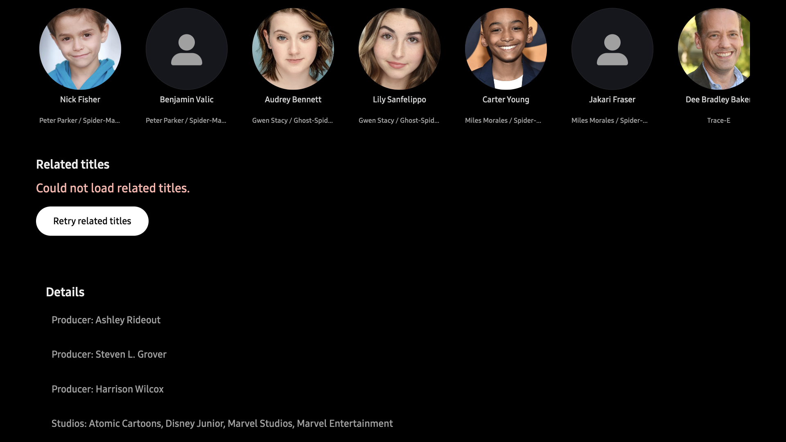
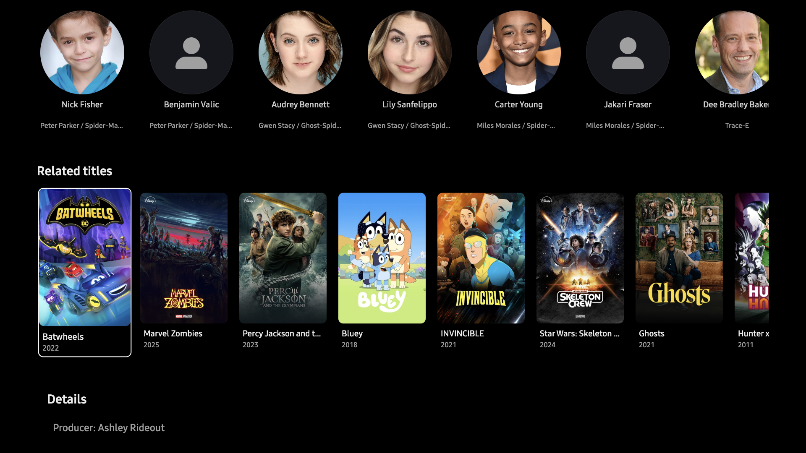

# Related-title response correction

The Similar endpoint returned HTTP 200 with an `items` collection containing 24 cards.
The old client rejected that response because it also required catalog pagination totals.
The corrected client rendered the cards without changing the request or Retry policy.

| Before | After |
| --- | --- |
|  |  |

Both captures show the same Spidey series and profile on 4 November 2026.
The baseline signed app used source `22dc1f489ce1270497450bfd28d1deccdc43ea70`, whose production bytes were merged into main before this correction.
The candidate used source `13354eb564e23a90dcb44cadfb2f7be205376a45`.
The visible images show public title and cast artwork plus anonymous UI state; no account identity, server/address, credential or desktop capture is included.

## Runtime and package identity

The Samsung TV simulator used SDK 10.0.6, Chromium 137, a 1920×1080 app viewport and device pixel ratio 2.
The signed candidate WGT had SHA-256 `5d1ed43b3f29ce214571e3eae0d959d5f25ff90f3d6a6468be10858d2d119074`.
All 15 installed archive files matched the package.
Loaded JavaScript matched the packaged build: SHA-256 `62bcee59171d971773872ff8bc5dc66a22ce595f56aaf48a03cd963ce2165f05`, 834339 bytes.

The desktop remained locked.
One persistent SDK debugging connection enabled focus emulation.
Profile and series entry used diagnostic pointer activation after launcher key input.
Screenshot framing used scripted focus and scroll to align the Related titles heading.
The observed request and DOM confirmed 24 rendered cards and no related Retry button; the screenshot shows only the visible portion of the row.

## Limits

These captures prove the response-decoding correction in the signed Samsung simulator.
They do not establish layout, remote-focus or whole-screen Apple parity.
No same-state Apple capture was made; tvOS was unavailable through the required device interface.
Physical TV, packaged-origin CORS and AVPlay were not checked.
The images remain here as regression documentation because GitHub attachment upload had no usable browser session.
