# Details layout and preplay evidence

This is a bounded Details improvement for [#92](https://github.com/Artic0din/silo-tizen/issues/92), not a whole-screen Apple parity PASS.
Movie actions now share one row, Version/Audio/Subtitles have focused dialogs, More retains personal actions and rating access, and series show season chips with an inline episode rail.
Issue #92 remains open for the differences below.

## Build and capture identity

- Current source: `602adac960eff4235420d93f8fb80631fd4f1022`, captured on 3 November 2026.
- Before source: `a922b4f551bbab4040163b800b51bcf197f0dc75`, captured earlier in the same session.
- Signed current WGT SHA-256: `b1bd6e089fb0d5be7ac2292221952d23d11f5a8a9853d8f3bbd11b6c2f4494fd`.
- Runtime: Samsung TV Simulator SDK 10.0.6, NW.js/Chromium `137.0.7151.69`; application viewport 1920×1080, device pixel ratio 2.
- Apple movie reference: historical 1 November capture associated with pinned Apple source `1a7cceeaf3b2bfc4f889c00487d19b2c6f843940`.

All 15 signed archive entries matched the installed application files.
The loaded JavaScript matched the packaged JavaScript byte-for-byte.
All 665 renderer CSS rules matched the packaged stylesheet parsed by the same browser engine.
The simulator sometimes returns reformatted CSS from its resource inspector, so a raw inspector-text hash is not used as proof of applied CSS.
See [installed assets](installed-assets.json) and [capture evidence](evidence.json).
The later documentation commit does not change the packaged application source.

The current PNGs are unresized 1920×1080 application captures.
The historical Apple PNG is 960×540; its original 1920×1080 application frame was captured at 50%.
No generated artwork, retouched controls, or reconstructed Apple screens are used.
Historical EXIF metadata was removed without re-encoding image pixels; color profiles were retained.

## Movie comparison

The before/current pair shows the same movie, selected Play control and visible movie metadata.
The separate action, membership and rating rows previously pushed cast portraits below the entry viewport.
The current first portrait starts at y=752 and is fully visible; the historical Apple frame places it at approximately y=760 when expressed at the same logical scale.
That observation does not establish identical layout or typography.
The baseline also recorded a related-title error below the entry viewport; no fix for that separate #90 behavior is claimed.

| Before: Samsung simulator | Current: Samsung simulator | Historical Apple reference |
| --- | --- | --- |
| 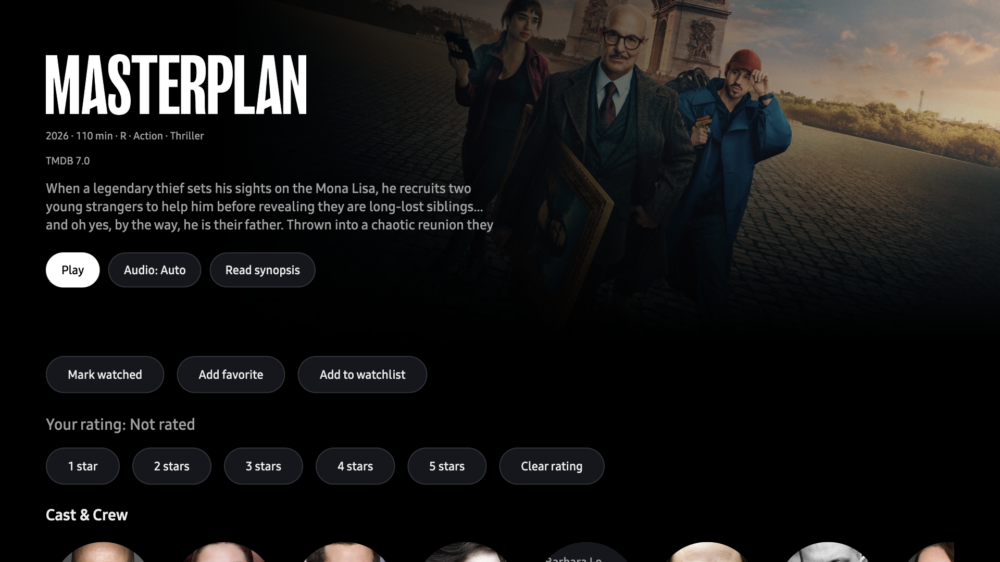 | 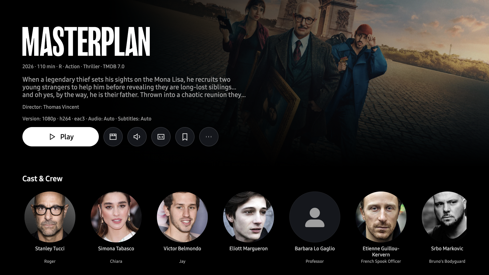 | 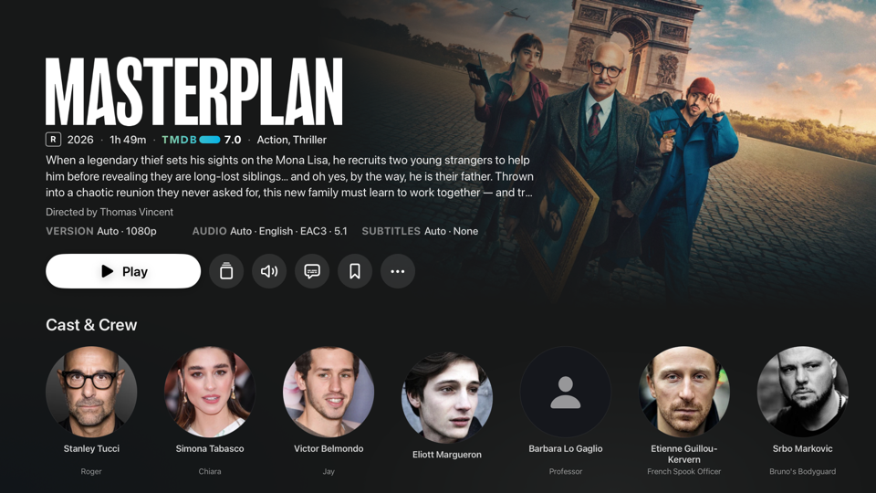 |

## Dialogs and focus

| Version | Audio | Subtitles |
| --- | --- | --- |
| 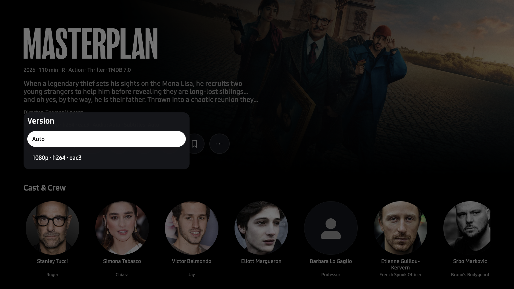 | 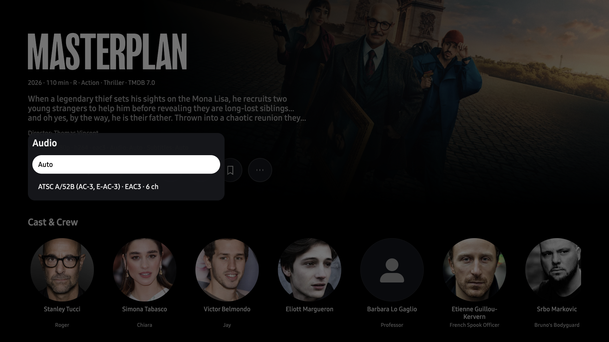 | 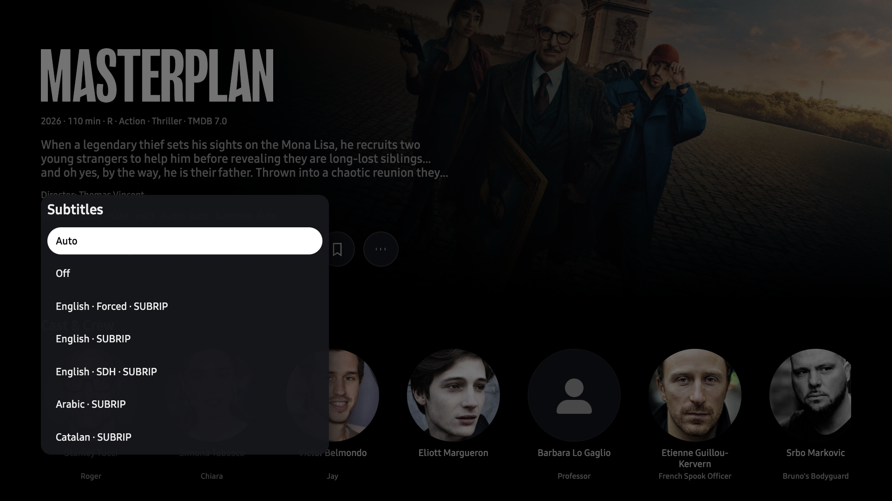 |

| More | Nested rating |
| --- | --- |
| 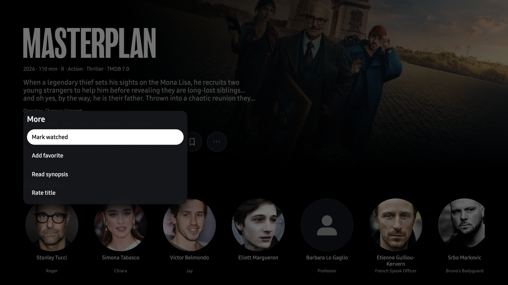 | 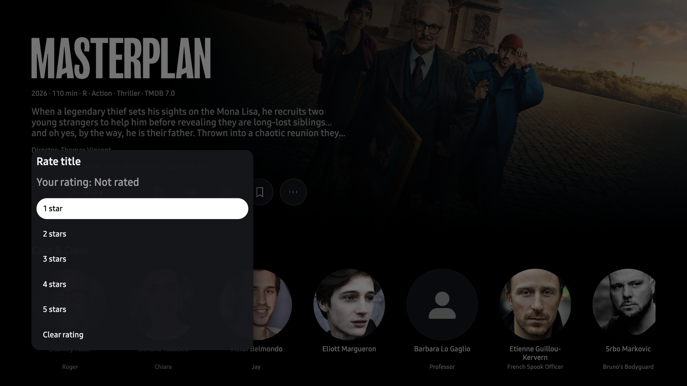 |

Trusted remote key events opened each dialog and returned to its initiating control.
The captured dialogs each left eight underlying content regions inert.
The nested rating journey returned first to Rate title in More, then to the main More control.
No live rating, membership, progress or subtitle-preference write was made during these captures.
Subtitle options retain language even when the server supplies generic stream titles such as SUBRIP.
The [short focus recording](movie-dialog-focus.mp4) shows dialog navigation in this signed build.
Its frames retain their measured capture timing; it is a sampled recording, not a frame-rate or animation-performance benchmark.

## Series and episode return

| Series entry | Explicit Season 2 selection |
| --- | --- |
| 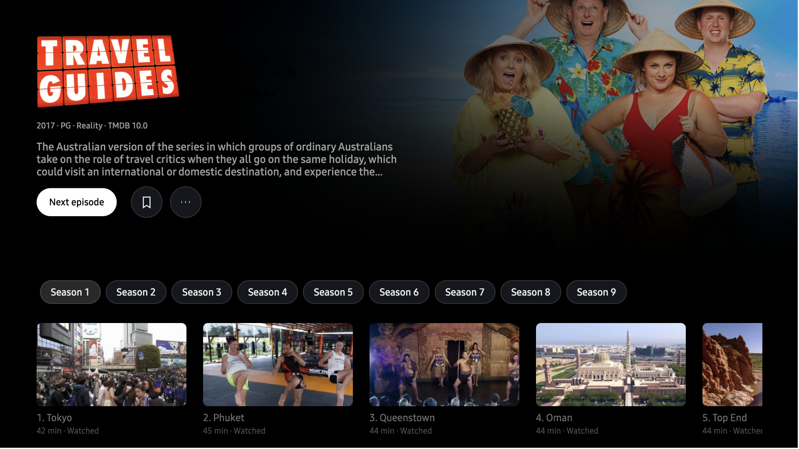 | 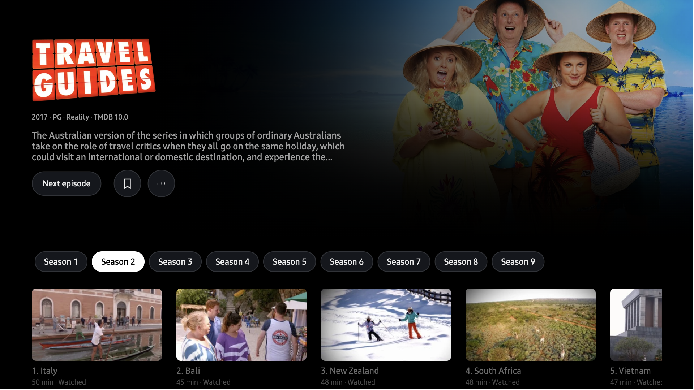 |

| Episode information | Back to the retained rail |
| --- | --- |
| 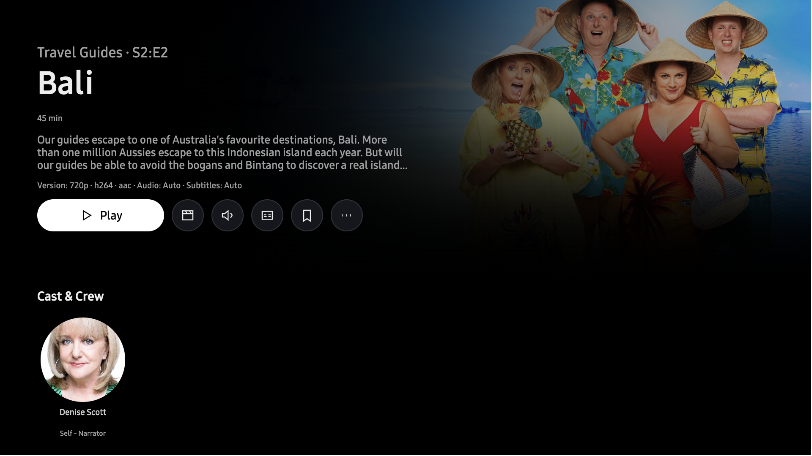 | 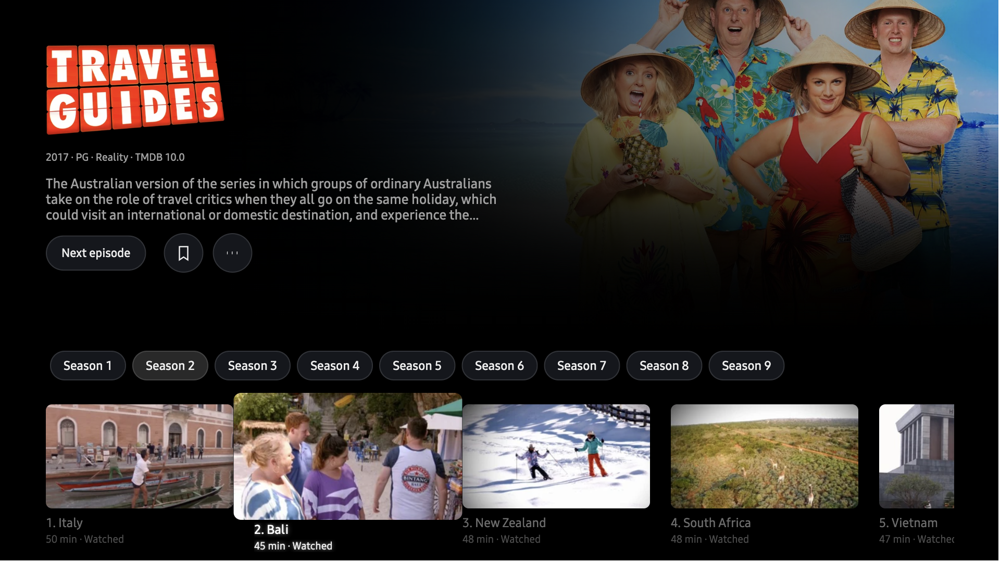 |

Moving from Season 1 to Season 2 focus made zero catalog reads.
Selecting Season 2 made one episode-list read.
Opening Episode 2 entered its existing information page.
Back restored Season 2 and Episode 2 without another catalog read.
Target titles were placed on screen through UI scrolling and trusted pointer activation; the demonstrated dialog, season and episode navigation used remote key events.

The series captures demonstrate the current Tizen behavior only.
They are not a matched Apple series comparison, and no baseline series screenshot is claimed.

## Automated and native proof

The final source gate passed both typechecks, the production build, 578 native tests and 660 UI tests.
Release-version checks passed 17/17; the earlier fixture-sync checks passed 11/11.
The independent source review passed 59 focused native tests; the later initial-subtitle correction passed 60 focused native tests.
Final source autoreviews and staged secret scans reported no findings.
Controlled regressions covered retained Calendar season context, accessible More status, initial subtitle refusal/cancellation, current-DOM Calendar targeting, and language labels.
The broader full suite covers loading, empty, error, retry and reduced-motion cases; those results are automated evidence, not additional native screenshots.

Early r2/r3 calibration captures, an r4 sequence that sent input before Home was ready, and the reformatted raw CSS inspector output are excluded from acceptance.
The committed current captures were route-checked and tied to the signed build above.
An earlier unexplained Calendar personal-action failure is not claimed fixed by later passing runs; #119 remains its separate tracker.

## Remaining differences and limits

1. Series still uses Next episode and opens episode information before playback.
   Direct play and Play/Resume S#:E# behavior remain [#93](https://github.com/Artic0din/silo-tizen/issues/93).
2. Subtitle selection lasts for this Details visit/play attempt.
   Apple-style persistent title/series overrides are not implemented here; downloaded subtitle choices remain in the player's authoritative inventory menu.
   Auto is resolved during playback preparation, so the passive Details summary states intent rather than an unverified effective track.
3. Title-art size, metadata order/formatting, synopsis wrapping, background tint, icons and dialog materials differ from the historical Apple frame.
   Inter and original SVG icons substitute for Apple's fonts and symbols; the existing Details backdrop remains in place.
   These differences remain visible #92/#97 work, not established Tizen platform limitations.
4. There is no matched current Apple series/dialog capture and no physical-TV run.
   Simulator-only work was explicitly requested until simulator parity is complete.
   The simulator's disabled web security cannot prove packaged-origin CORS, and this evidence does not establish Tizen 8/Chromium 108 rendering, AVPlay playback, subtitle delivery or physical remote behavior.

No server, AVPlay transport, decoder, transcoding or capability declaration was changed for this slice.
